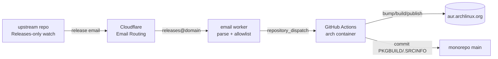

# aur — unified PKGBUILD monorepo + release automation

All maintained PKGBUILDs live in `packages/<dir>/`, each with a `meta.json`
manifest. Upstream release emails relay through Cloudflare into GitHub
Actions, which bump, build-test, and push to AUR — no polling.



## Layout

| Path | Purpose |
|---|---|
| `packages/<dir>/PKGBUILD` | the package (source of truth) |
| `packages/<dir>/meta.json` | `aur` (publish to AUR?), `watch` (upstream mapping), `build_test` |
| `packages/<dir>/.SRCINFO` | generated by `tools/bump.sh`, committed |
| `index.json` | generated: github repo → packages (consumed by worker + CI) |
| `tools/` | bump / mksums / build / publish / release / gen-index / validate |
| `worker/` | Cloudflare email worker |
| `.github/workflows/upstream-release.yml` | dispatch + manual pipeline |
| `.attic/` | quarantined `.git` dirs from the old per-package clones (ignored) |

## Release flow (watched packages)

1. GitHub sends a release notification email to `releases@<your domain>`.
2. The Cloudflare email worker verifies the sender + DKIM, extracts
   `owner/repo` + tag from `/releases/tag/<tag>` links (subject fallback),
   and POSTs a `repository_dispatch` (`upstream-release`) to this repo.
3. The workflow, in an `archlinux:base-devel` container, resolves the repo
   via `index.json` to packages, then for each:
   `bump.sh` (pkgver + `pkgrel=1` + all-arch checksums + .SRCINFO, atomic
   staging) → `build.sh` (makepkg build test) → `publish.sh` (push to AUR
   + commit monorepo).
4. Already-current versions are skipped (exit 3); a 404 tag aborts that
   package with the tree untouched.
5. Transient failures are retried (bump 3×, build/publish 2×) and the
   monorepo push rebases onto a moved `main` (`validate.yml` regenerates
   `index.json`). Downloaded sources are never committed: the AUR rejects
   blobs over 488 KiB, so `publish.sh` publishes tracked files only,
   untracks oversized artifacts, and aborts if a file the PKGBUILD needs
   exceeds the limit.

Checksums: `tools/mksums.sh` re-resolves every source array
(any/x86_64/aarch64/armv7h/i686) by sourcing the PKGBUILD per CARCH and
downloading each artifact — `updpkgsums` only handles the running arch and
silently stales the rest. VCS sources get `SKIP`; source-less metapackages
are skipped. `build.sh` downloads into `src.d/` (gitignored) instead of
next to the PKGBUILD.

## Local usage

```sh
tools/release.sh <dir> <tag>   # bump + build + publish (same code as CI)
tools/release.sh <dir>         # rebuild + publish current state
tools/mksums.sh <dir>          # checksums only
tools/validate.sh              # meta/index/PKGBUILD sanity (CI runs this)
```

Manual dispatch without an email: Actions → `upstream-release` →
package (`all` = every watched package) + optional tag (empty = resync
current state to AUR).

## One-time setup

1. **GitHub repo**: create from this directory
   (`gh repo create xihale/aur --private --source=. --push` or public).
2. **Secret `AUR_SSH_KEY`**: your AUR SSH private key (repo → Settings →
   Secrets → Actions). Without it the pipeline bumps/commits but skips
   AUR push.
3. **Cloudflare worker**:
   ```sh
   cd worker && bun install
   wrangler secret put GITHUB_TOKEN   # fine-grained PAT on xihale/aur, Contents: read+write
   wrangler deploy
   ```
   Then in the Cloudflare dashboard: Email Routing → enable on your
   domain → routing rule for `releases@<domain>` → **Send to a Worker** →
   `aur-release-relay`.
4. **GitHub watch**: on every upstream repo in `index.json`, Watch →
   Custom → **Releases only**, and make sure notification email goes to
   the address routed above (GitHub → Settings → Notifications).

## Adding a package

```sh
mkdir packages/<dir>            # + PKGBUILD
echo '{"aur": true, "watch": {"github": "owner/repo", "tag_to_pkgver": ["s/^v//"]}, "build_test": true}' > packages/<dir>/meta.json
(cd packages/<dir> && makepkg --printsrcinfo > .SRCINFO)
tools/gen-index.sh && tools/validate.sh
```

`tag_to_pkgver` is a list of sed expressions run over the tag; `[]`
= tag used verbatim (e.g. v2rayN tags `7.25.4`); `["s/^v//", "s/-/./g"]`
for con-terminal-style `v0.1.0-beta.58` → `0.1.0.beta.58`.

Watch the repo in GitHub (Releases only) and you're done.

## Package status (2026-10-20)

Watched (automatic): strix-bin, cli-proxy-api-bin, snirect, snirect-bin,
v2rayn-bin, cloudpan189-go-mauruppi-bin, ncmdump-latest-bin, ely-doc-bin,
ely-mark-bin, ely-pdf-bin, ely-show-bin, ely-table-bin, ely-tree-bin and
the `ely-office-bin` metapackage pulling all six (ELY-Open-Source/ElyOffice,
ships ready Arch packages under `/opt/ely-office/<app>`, repackaged
verbatim) + WIP: codexmanager (CodexManager/), clirelay-bin,
con-terminal-bin, gdut_course_grabber. ELYTerminal is already packaged on
AUR as `elyterminal-bin`, so it is not mirrored here.

Manual (no release emails to follow): moonbit-bin/qoder (rolling latest
URLs), awesunhost-bin (oray), moshi-bin (cdn.getmoshi.app),
unlock-music-cli-bin (Gitea), zcode-bin (vendor .deb), gcc16.

No maintenance needed: `*-git` packages (motrix, ziggy, supermd, weflow,
con-terminal, affine-*-dev) and sqlmap (official Arch packaging, stays at
root, excluded).
